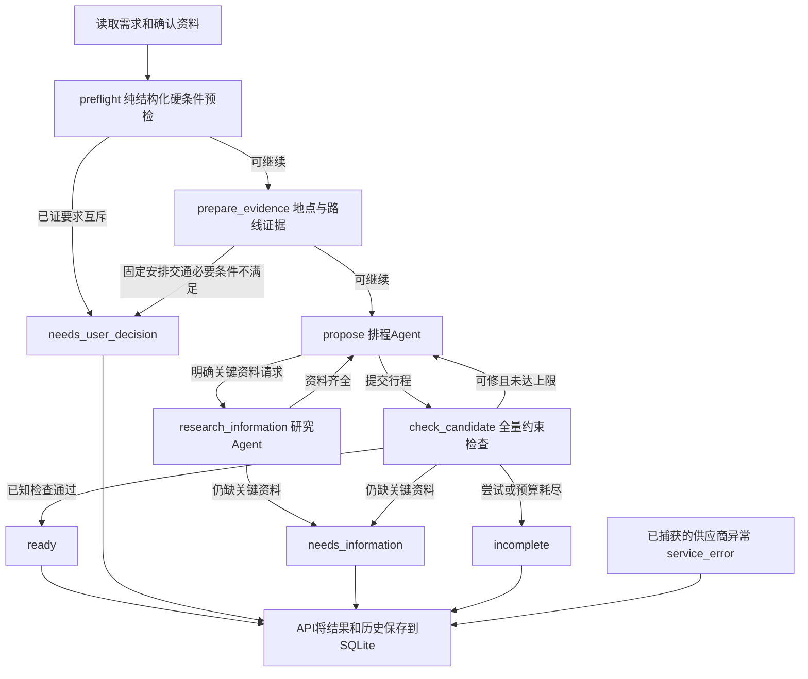

# TripWeave 目标技术栈与 Agent 架构

更新：2026-11-13。本文对应当前尚未提交的工作区。项目面向中国大陆校招 Agent 应用工程岗位，SW继续承担Java后端项目的分工。

当前已实现**按需事实研究Agent与排程Agent**，由LangGraph的普通节点和条件边控制交接；初始选景排序、分组和推荐摘要仍是HTTP函数流水线，不属于研究Agent。用户最新要求先完成核心架构，质量与成本的效果评估后置，本轮未安装评测或提示词优化框架。实际链路见[CORE_FLOW](CORE_FLOW.md)，角色边界见[MULTI_AGENT_PLAN](MULTI_AGENT_PLAN.md)。

## 当前技术栈

| 层 | 技术与状态 | 在 TripWeave 中的职责 |
| --- | --- | --- |
| API与业务合同 | Python 3.14、FastAPI、Pydantic，已使用 | 读取需求快照，约束地点、多个可选日期窗口与固定预约，返回行程、资料缺口或明确处理结果。 |
| Agent编排 | LangGraph，已接入 | 用StateGraph定义preflight、prepare_evidence、propose、research_information、check_candidate，通过条件边决定继续、补查、修订或结束。 |
| 模型与两个角色 | DeepSeek、OpenAI兼容SDK、Pydantic AI Slim，已使用 | 排程Agent调用地图/餐厅工具并输出行程或资料请求；研究Agent持独立消息历史，只查询指定地点和日期。两者共享同次规划模型请求上限。 |
| 地图与约束检查 | 高德Web API、HTTPX2、Python规则，已使用 | 地图提供已知地点和路线耗时。程序检查必去、固定预约、完整停留窗口、活动数量、交通、重复体验与酒店收尾；模型决定体验取舍与灵活站点调整。 |
| 业务持久化 | SQLAlchemy Core＋SQLite，已验证；PostgreSQL已有适配 | 保存需求、选择及证据、候选、失败草稿、定向研究事实、接受版本和历史。真实PostgreSQL集成测试仍待环境。 |
| Web | 原生HTML/CSS/JS，已使用 | 分步需求、可选景点时间要求、选景确认、五类结果和历史；失败草稿仅提示保存，不作为可接受行程展示。 |
| 工程验证 | uv、pytest、Ruff、HTTP MockTransport、Node状态测试，已使用 | 用固定工具响应和脚本化模型输出检查角色交接、来源绑定、图路由、版本和接受门禁。模拟验证与真实供应商效果分开记录。 |

本轮没有升级依赖，具体构建版本以`uv.lock`为准。原2026-11-10技术调研曾核对LangGraph 1.2.20发行包及本机环境，该数字作为当时快照保留，不能据此宣称最新发行版本。[Graph API](https://docs.langchain.com/oss/python/langgraph/graph-api) · [原核对发行页](https://pypi.org/project/langgraph/1.2.20/)

## 当前角色和合同

- **排程Agent**：读取当前需求、用户确认的选景快照、最新草稿和必要事实；输出`Itinerary`，或用`PlanningInformationRequest`明确缺哪些地点、日期与字段。普通草稿错误按具体日期局部修订，其他天作为参考，合并后全量校验。
- **按需研究Agent**：通过受限搜索工具补`opening_hours`、`last_admission`、`reservation_rules`；仅允许本轮已知地点及所请求日期，不重新推荐景点，不任意扩展搜索目标。返回`ResearchReport`，引用实际取得的来源与原文片段，缺失保持未知。
- **普通程序节点**：负责合同、地点身份、约束、证据绑定、预算边界、图状态和事务保存。网页命令不构成权限，研究输出不能覆盖用户固定要求。

`visit_constraints`支持最多10条显式必去时间要求，每条有唯一约束ID、明确地点、至少停留时长和一个或多个日期窗口。多个窗口表示任选其一，整段停留须落在所选窗口内；`fixed=true`表示单个精确预约时段。原有单预约字段继续兼容。页面能编辑同一时段的多个可选日期，复杂已有窗口完整只读保留，不静默改写。

研究结果的`web_reported`表示来源与引用绑定检查通过，不是对现实营业、预约可得性或官方身份的保证。可用的时间字段参与候选检查；仅凭模型提取或未查到资料，不能宣布用户要求无解。初始选景仍只提供简介、人群和照片，不对所有候选逐个展开预约核验。

## 当前图的执行方式

纯结构化预检在地图和模型调用前发现可直接证明的矛盾，例如精确预约超过每日边界；地点解析后再次核对身份与固定安排的交通必要条件。只有已知要求确实互斥才返回用户取舍，不因为两个景点都21点入场就忽略它们可能分两天安排。

现有错误定位包含日期、站序、地点和期望/实际值。局部修订保留其他天及仍正确的安排，禁止模型超范围提交；新事实可能影响多天时提供完整最新草稿，修订后仍全量检查。程序不直接搬动或顺延灵活景点来替代模型的体验判断。

## 结果、状态与持久化

| outcome | 含义与处理 |
| --- | --- |
| `ready` | 通过当前已知合同、事实与业务检查的候选，仍需核对未验证事项；不是实际订房或预约成功。 |
| `needs_information` | 关键事实补查后仍不足，或需要新的资料请求但本轮研究回流已用完；显示具体缺口。 |
| `needs_user_decision` | 结构化已知硬条件或固定安排交通必要条件互斥，请用户调整需求，不自动删必去或改预约。 |
| `incomplete` | 有限尝试、共享请求预算、时限等导致本次未完成；不等于需求无解。 |
| `service_error` | 已捕获的供应商连接、权限或响应异常；和旅行要求冲突分开显示。 |

为兼容旧记录，`status`继续保留`ready/conflict`，新页面使用`outcome`区分原因。只有真正`ready`且需求版本、接受版本仍有效的候选可接受。

图内维护草稿、问题、角色消息、研究请求/事实、尝试次数和研究轮次；正常返回及已捕获失败的结果由API保存到SQLite候选JSON，包含失败`draft`与`research_facts`。用户刷新可回读记录和已确认资料。**这不是LangGraph checkpoint续跑**：没有后台任务或任意节点崩溃恢复，重启后的新规划请求不会自动从失败节点接着执行。

## 现有边界与后续顺序

单次规划仍受原有最多6次模型请求和90秒约束；排程、研究工具循环和格式重试共用这份额度。定向研究最多一轮、最多5次网页搜索，同一地点/日期复用本轮结果，高德保留原调用上限。进入研究角色不重置预算。

初始选景、换批和后续排程属于不同用户请求，尚未实现跨这些阶段的全程统一预算或费用评估，不能声称已有整趟费用上限。用户最新明确后置质量与成本评估，因此本轮不接Pydantic Evals、DSPy或新的追踪平台；先保留现有边界，把架构跑通。

后续先由用户审阅结构化要求、研究回流与失败结果，再按明确需求处理跨请求草稿续做、checkpoint、后台任务或SSE。MCP、百度适配、Redis与向量检索均仍按具体缺口评估，不因已有两个Agent就自动增加中间件。

## 当前验证范围

本轮Python **256 passed、4 PostgreSQL skipped**，前端Node **27 passed**；包含两个角色使用真实Pydantic AI SDK与HTTP模拟响应的交接、搜索权限、引用绑定、资料不足、硬冲突和用量上限检查。它们证明合同与执行路径，不证明真实模型规划质量。

浏览器只检查新表单和纯预检的静态矛盾结果，所测路径**0地图、0模型调用**。本机服务地址为`http://127.0.0.1:8776/`，新架构已加载；本轮没有新增真实双Agent规划，未用新模型调用验证研究效果。此前几次真实成功或失败属于历史基线，统一见[QA记录](evaluations/V02_QA.md)，不混为本轮验证。

## 开源参考（2026-11-10调研快照）

以下为2026-11-10原调研快照；Star、第三方依赖和更新记录均不是本轮重新核查的最新事实。样本覆盖高关注产品、接近本项目的 Agent 实现和规划评测，未运行第三方项目或复用其代码。

| 项目 | 技术栈与架构 | 可借鉴的设计 |
| --- | --- | --- |
| **TREK，约 15.5k Stars** | Node.js workspace 按 client、server、shared 分层。React/Vite 客户端、NestJS 服务端，MikroORM 接入 SQLite 并提供 PostgreSQL 相关依赖。行程可编辑，AI 助手和 MCP 可按部署开关。 | 行程和编辑历史由业务层持有。生成只是入口，用户可继续查看、修改和确认。适合作为产品与数据边界参考。 [仓库](https://github.com/liketrek/TREK) · [前端依赖](https://github.com/liketrek/TREK/blob/main/client/package.json) · [后端依赖](https://github.com/liketrek/TREK/blob/main/server/package.json) |
| **FloatTrip，77 Stars** | FastAPI、LangGraph、SQLite checkpoint、高德、OR-Tools CP-SAT。项目文档区分默认新规划子图与修改子图，默认运行时通过 SSE 发送进度。 | 同样面向高德地点的场景，可重点参考模型补充候选语义、程序排程与独立质量检查的职责分配。checkpoint 和事件回放的边界单独设计。 [仓库](https://github.com/shouzhuoshouzhuo/FloatTrip) · [后端依赖](https://github.com/shouzhuoshouzhuo/FloatTrip/blob/main/requirements.txt) · [运行时设计](https://github.com/shouzhuoshouzhuo/FloatTrip/blob/main/docs/agent-runtime.md) |
| **Yuntu，54 Stars** | 2026-11-10调研时观察到2026年11月有更新记录。Python/FastAPI、PostgreSQL、高德和 React/Vite。项目文档把已验证 POI 检索、空间聚类、路线可行性、文案生成和发布门禁分开。本地种子数据聚焦重庆。 | 先用真实地点和程序计算构造可执行结构，再让模型补充解释。发布前独立验证路线、地点和价格声明。 [仓库](https://github.com/Trunks820/Yuntu) · [后端依赖](https://github.com/Trunks820/Yuntu/blob/main/requirements.txt) |
| **OSU TravelPlanner，569 Stars** | ICML 2024 的评测项目。Python 仓库区分 agent、工具、数据库、输出后处理与评估。 | 固定输入和工具证据，分别测格式、业务约束和整份行程通过率。TripWeave 可用自建的中文、高德风格样本覆盖实际失败。 [仓库](https://github.com/OSU-NLP-Group/TravelPlanner) · [评估目录](https://github.com/OSU-NLP-Group/TravelPlanner/tree/main/evaluation) |

## 2026-11-14 真实验证更新

此前“未做真实双角色联调”是2026-11-13状态，现已被一次真实回流样本补充：首次因服务沙箱网络10013失败、模型0；修正启动环境后，经用户另行授权再试，同输入24.706秒、6模型/17地图/1搜索，研究返回官网常规开放等3字段，排程生成草稿，但9项业务错误未通过且额度耗尽未完成修订，outcome=incomplete。两条记录保存，均未接受。证明实际研究交接发生，不证明最终规划可行或效果稳定。细节与截图见[evaluations/V02_QA.md](evaluations/V02_QA.md)，本轮未改业务代码、未再发第三次规划。
