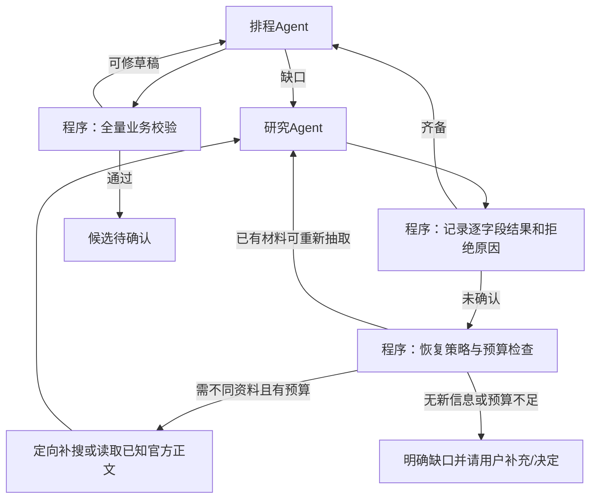

# 旅游 Agent 架构源码对照与 TripWeave 下一步建议

核对：2026-11-15。回应用户“是否增加第三个Agent，还是先完善程序和提示词”。本文件是源码调研与建议，**未新增第三个Agent、未改变运行链路或预算、未调用真实模型/地图/搜索**。公开代码和论文均未部署复现，不能当作我们项目的效果证明。

## 结论

当前先完成“明确失败原因＋按原因恢复”的程序节点，继续使用排程/研究两个角色。提示词说明输入输出语义，程序管理事实引用、分支、版本和额度。多个业务角色可以降低单个模型的职责负担，但不会自动产生缺失资料、纠正错误分支或证明规划可行。

第三个角色将来更适合做体验评审：结合用户偏好和景点资料，指出过累、体验雷同或偏好满足不足，并给排程修改建议。确定的时间算术、地点身份与硬约束仍由程序检查；事实不足仍交研究补查。按需的恢复协调Agent也可以作为后续实验，但需要先有可供它判断的具体诊断和允许动作，当前不把新增角色当作成功保障。

## 核对方式及版本边界

对公开源码做只读检查，固定提交并在本地忽略目录缓存20个README/源码文件及SHA-256清单，另阅读论文方法与局限。没有运行下载的Python、不安装其依赖、不配置其外部API。

GitHub匿名REST API遭遇限流，改用只读Git元数据和固定版本文件；没有用我们的服务Key访问GitHub。发现网页索引里的Google与LangGraph路径已迁移，实际查Git历史，不把旧页面包装成当前版本。

| 参考 | 本次版本 | 适用边界 |
| --- | --- | --- |
| FloatTrip | `8c8972f5c82b2bf7bdf99b6874c3b7a3d95a6971`，提交日2026-09-26 | 与我们同用高德/DeepSeek/LangGraph；社区项目，未验证其真实质量 |
| LangGraph官方旅行客服 | `23961cff61a42b52525f3b20b4094d8d2fba1744` | 官方历史教程；当前examples只保留迁移提示，不当作新版API样板 |
| Google Travel Concierge | 删除旧目录前父提交`0521e23a290f21e00c52129a7863965a676e3f95` | 历史演示；许多预订能力为模拟，不能用于证明真实可订 |
| CrewAI Trip Planner | `da94a91e691e1cf5b3151416bb15b5b62729bea8` | 官方样例集合；仓库已于2026-04-20归档，学习分工，不据此换依赖 |
| TravelPlanner | `e52c87f4ac348a3410c46dc3553c519db5ec5e23` | ICML 2024基准代码，主要用离线数据库，不是实时旅游产品 |
| HiMAP-Travel | arXiv `2603.04750v1`，2026-03-05 | 分层规划研究，含GRPO训练，论文结论未由我们复现 |

不把父仓库star数当作某个旅游样例的独立采用量，也不把star当正确性证据。源码缓存与清单位于`.runtime/architecture-references-20261115/`，不会随公开文档上传。

## 1. FloatTrip：主Agent、规划子图与质量门分工

实际主入口用`create_agent`组织受控工具；新规划按天气/地点查询、候选语义、确定性优化和质量检查分层。`quality_gate_node`将具体violations交回候选修复，耗尽修复次数后报错。已有行程修改另走Planner/Reviewer循环；修改评审达到上限后进入后续环节，不能把这个分支解释成评审通过。

我们可借鉴的是**具体失败反馈和有上限的恢复循环**。其CP-SAT直接参与选点与排程，而用户已明确TripWeave的体验取舍由模型负责，因此不直接复制其选点决策或自动搬动景点。

源码：[规划/修改图](https://github.com/shouzhuoshouzhuo/FloatTrip/blob/8c8972f5c82b2bf7bdf99b6874c3b7a3d95a6971/app/planning/graph.py)、[质量门与修复反馈](https://github.com/shouzhuoshouzhuo/FloatTrip/blob/8c8972f5c82b2bf7bdf99b6874c3b7a3d95a6971/app/planning/nodes.py)、[主Agent](https://github.com/shouzhuoshouzhuo/FloatTrip/blob/8c8972f5c82b2bf7bdf99b6874c3b7a3d95a6971/app/chat/react_graph.py)、[优化器](https://github.com/shouzhuoshouzhuo/FloatTrip/blob/8c8972f5c82b2bf7bdf99b6874c3b7a3d95a6971/app/planning/optimizer.py)。

## 2. LangGraph官方旅行客服：子任务可以交回主流程

教程把主助手、航班、酒店、租车和游览作为专业流程。`CompleteOrEscalate`让专业助手结束自己的任务并交回主助手；`leave_skill`弹出对话栈，再进入`primary_assistant`。工具异常作为关联tool_call的错误消息返回，给模型修正机会。敏感工具另外中断，规则仍由工具/API执行。

最相关的启发是：**一个子任务暂时失败不必等同于整次请求结束**。但其回交是在旅行客服对话里实现，并未解决我们的证据缺失问题；还要为TripWeave定义允许的恢复动作与预算。

源码：[固定版本Notebook](https://github.com/langchain-ai/langgraph/blob/23961cff61a42b52525f3b20b4094d8d2fba1744/docs/docs/tutorials/customer-support/customer-support.ipynb)。重点符号为`handle_tool_error`、`CompleteOrEscalate`、`pop_dialog_state`、`route_primary_assistant`。原工具主要使用教程SQLite数据，不是完整实时预订系统。

## 3. Google Travel Concierge：按用户旅程拆角色

历史源码有一个根Agent，按灵感、规划、预订、出行前/中/后六类业务转交。规划角色把航班/酒店选择和JSON行程生成作为AgentTool，并用schema、output_key和会话状态交接。这些角色拆分对应业务边界；根Agent不是万能的正确性裁判。README明确航班、酒店、预订及支付有多项模拟能力。

可借鉴的是明确职责、工具集合及结构化交接。我们暂时没有完整订票/支付/旅后服务，不照搬六阶段和大量角色。Google旧adk-samples地址现转向adk-recipes，2026-10-02删除了原python目录；因此链接固定到删除前版本。

源码：[根Agent](https://github.com/google/adk-recipes/blob/0521e23a290f21e00c52129a7863965a676e3f95/python/agents/travel-concierge/travel_concierge/agent.py)、[规划子角色](https://github.com/google/adk-recipes/blob/0521e23a290f21e00c52129a7863965a676e3f95/python/agents/travel-concierge/travel_concierge/sub_agents/planning/agent.py)、[演示边界](https://github.com/google/adk-recipes/blob/0521e23a290f21e00c52129a7863965a676e3f95/python/agents/travel-concierge/README.md)、[删除提交](https://github.com/google/adk-recipes/commit/ede41c75323b5771f2177234c8db391f1360125e)。

## 4. CrewAI：三个业务角色不等于三个校验层

样例的三个角色分别选择城市、整理当地资料、输出旅行安排。入口将三个任务交给Crew；各角色有搜索/抓网页工具。浏览工具还会按正文分块创建额外摘要Agent，因此顶层三个角色不等于固定三次模型调用。最终任务要求Markdown七日安排，不能据此声称具备我们的按分钟衔接/四指标/证据采信校验。

我们城市已由用户决定，新增选城Agent没有直接用途。可借鉴搜索后按需读取网页内容；不复制每个分块再调用模型的成本路径，也不靠角色数量判断工程深度。

源码：[任务入口](https://github.com/crewAIInc/crewAI-examples/blob/da94a91e691e1cf5b3151416bb15b5b62729bea8/crews/trip_planner/main.py)、[角色](https://github.com/crewAIInc/crewAI-examples/blob/da94a91e691e1cf5b3151416bb15b5b62729bea8/crews/trip_planner/trip_agents.py)、[任务](https://github.com/crewAIInc/crewAI-examples/blob/da94a91e691e1cf5b3151416bb15b5b62729bea8/crews/trip_planner/trip_tasks.py)、[网页摘要工具](https://github.com/crewAIInc/crewAI-examples/blob/da94a91e691e1cf5b3151416bb15b5b62729bea8/crews/trip_planner/tools/browser_tools.py)。

## 5. 基准与新研究：约束和恢复仍需要独立机制

TravelPlanner两阶段模式先收集信息再规划，另有常识/硬约束的程序评估；工具Agent将具体参数错误放进观察，记录重试次数并检测重复动作。其离线数据、专用规则和旧接口不能直接作为实时数据方案。

HiMAP-Travel提出协调者、按天执行者、共享状态监控与结构化失败回交，明确界定有限的重规划过程。监控预算/去重是程序机制，角色策略还经过GRPO训练；并行加快并不意味着tokens减少。对我们最有价值的是短小、有身份的失败反馈和全局约束共享，当前不迁移训练体系或按天并行；用户要求的跨天体验取舍仍需保留。

源码：[工具Agent](https://github.com/OSU-NLP-Group/TravelPlanner/blob/e52c87f4ac348a3410c46dc3553c519db5ec5e23/agents/tool_agents.py)、[常识校验](https://github.com/OSU-NLP-Group/TravelPlanner/blob/e52c87f4ac348a3410c46dc3553c519db5ec5e23/evaluation/commonsense_constraint.py)、[硬约束校验](https://github.com/OSU-NLP-Group/TravelPlanner/blob/e52c87f4ac348a3410c46dc3553c519db5ec5e23/evaluation/hard_constraint.py)。论文：[HiMAP-Travel方法及局限](https://arxiv.org/html/2603.04750v1)。

## 对TripWeave的具体建议（待实施）

目前unknown可能来自检索、研究输出、证据绑定或时间结构；最后统一needs_information再END，丢失了恢复所需的区别。建议先落地以下合同，按地点/day/field/source定位，已有资料在图状态和候选中受控保存。

| 原因 | 判断依据 | 优先动作 |
| --- | --- | --- |
| 搜索结果为空 | 接口成功且results为空 | 改关键词定向再查；保持场馆/城市身份不变 |
| 模型明确unknown | 研究报告对应字段状态 | 看已有摘要是否足够；不足才补搜索/官方正文 |
| 来源编号无效/引用不匹配 | 程序校验实际检索材料 | 带具体拒绝原因重抽取已有资料，避免重搜 |
| 日期不适用 | 引文明确属于其他日期 | 定向补查该日期；不把常规营业表当未来保证 |
| 时间端点不足 | 已找到内容但无完整窗口/最晚入场 | 仅补该字段，不重新研究整座城市 |
| 服务/权限/限流异常 | HTTP与响应格式错误 | 保留服务原因，按可重试性和预算处理 |
| 用户硬条件已证实互斥 | 现有程序预检与约束证据 | 请用户选择，不靠多Agent投票放宽要求 |

这个图是改造建议，不是当前实现。恢复不得绕过证据验证、偷偷删除必去/固定预约，或自动把轻松游玩改成赶路。补查应有次数/时间/输出边界和无进展判断，并为回到排程留出请求额度。

按典型路径估算：排程一次请求、研究工具往返两次已占3次；若第三个诊断Agent再占1次，仅剩2次，未必够继续研究并排程。因此现在先用程序处理可确定的原因，避免新增角色挤占真正生成方案的预算。预留额度也只是可执行机会，不承诺一次调用必定成功。

之后若体验评审成为独立且可验证的需求，再做按需Reviewer：仅在有草稿和足够景点资料时运行，输出问题位置、偏好依据和修改建议；排程负责取舍，程序再次全量校验。是否更好、更省，应另用相同输入做小样本对照，不在本轮默认开启或增加额度。
