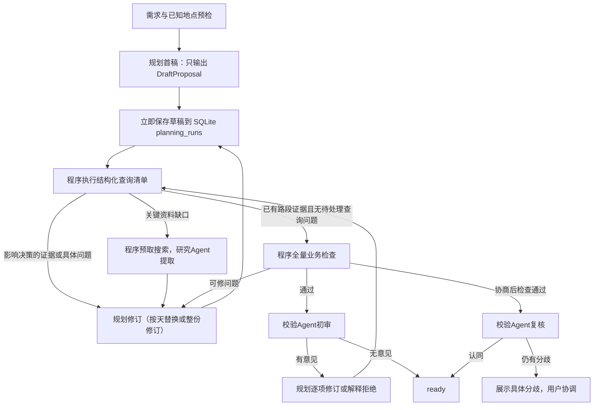

# 草稿优先与结构化查询

2026-11-23 更新了按决策影响分流、按天修订、路线表和关键事实核验。最新离线验证见 [QA](evaluations/V02_QA.md)。

更新：2026-11-17。本轮复用现有 LangGraph、Pydantic AI、SQLite 和三个业务角色，不新增框架或 Agent。草稿优先协议435项Python/52项Node通过；一次真实测试已保存草稿与清单，但180秒超时，没有可接受方案，详见[真实记录](evaluations/DRAFT_FIRST_LIVE_20261117.md)与[QA](evaluations/V02_QA.md)。不沿用旧真实流程的成功率或费用作为新版效果。

## 一次规划怎么执行



首稿与修订都由同一规划角色完成。每次调用只暴露结构化输出工具 `draft_proposal`，不暴露 `route`、`nearby_restaurants`、`lookup_places` 等普通工具。不是在旧工具循环上增加一句“尽快出稿”。SDK 的格式纠正仍可能额外调用模型，全部计入统一预算，不能承诺任何输出都恰好一次成功。

首稿只做结构、身份、明确时段等轻量检查，不在模型提交草稿之前追查所有路线。暂定安排允许等待核实，未知营业、价格、房型和预订不能写成已经确认。餐饮可用已知景点/起点/酒店 ID 作“附近自选正餐”的区域锚点；酒店引用已查候选并保留手选身份。

## 输出合同

首稿和全局修订显式提交四个字段。局部修订使用相同的 `draft_proposal` 工具名称，将其中的 `draft` 换成 `patch`。合同定义见 [draft_contracts.py](../tripweave/draft_contracts.py)。

| 字段 | 含义 |
| --- | --- |
| `draft` | 当前完整 `Itinerary`，包括拟定日期、地点、时段和酒店；尚不是可接受候选。 |
| `query_requests` | 最多24条普通地图查询，每条有具体 `reason`。没有新增查询时返回空列表。 |
| `information_needs` | 最多5条 `PlanningNeed`，沿用已知地点、旅行day、所缺字段与具体问题。须解释为什么影响用户要求或拟安排；纯介绍性未知放在假设说明。 |
| `assumptions` | 最多10条暂定假设或仍待确认事项，不把它们升级为真实事实。 |

路线用简单条件识别，不让模型维护复杂版本：

```json
{
  "kind": "route",
  "origin_id": "已知起点ID",
  "destination_id": "已知终点ID",
  "transport": "mixed",
  "reason": "核对从上一站结束后能否赶上拟定入馆时间"
}
```

另有 `nearby_restaurants`（`place_id`、原因，影响当前排程时填 `purpose=required_for_plan`）与 `place_search`（明确名称、原因）。程序绑定当前城市与服务地址，不接受模型传入自定义 URL、城市、Key 或静默改交通偏好。地点搜索仅允许用户明确提出、或确实出现在本次修订说明中的名称。`place_id` 必须来自本次已核实身份，不能找附近地点代替用户指定的不同地点。

## 程序执行清单

[QueryExecutor](../tripweave/query_executor.py)负责验证、执行、缓存和逐项返回，不调用模型、不安排站点。结果包含查询条件、`status/data/error/code`、是否缓存、是否首次交付新信息、阶段和模型轮号、执行耗时；失败和因预算未执行都不能包装成空的成功结果。

路线缓存键为“起点ID、终点ID、交通方式”；方向不同是不同路段，理由换一种说法不是新查询。同一轮规划中，已有路线、餐饮、地点搜索的成功或已尝试失败结果均可复用，避免同样失败反复消耗服务配额。新路线应由模型写入清单；程序核对草稿中是否仍有漏查相邻段，再把明确的 `required_queries` 交回模型，不能默默忽略。核对覆盖每日首段、过夜后酒店起点及实际回酒店路段。

重复清单保存在本次执行的内存中，不增加跨请求缓存或复杂版本机制。复用缓存本身不是错误：结合行程实际安排、查询条件和事实是否变化判断无进展，不能仅改说明文字或换查询顺序就重置计数。持续同稿、重复查询且没有新增信息或修订时，明确结束为未完成并保留草稿。

修订使用需求、最新完整草稿、精简地点字段、当前查询结果、已采信事实和具体错误，不默认堆积规划角色的全部工具历史或私有思考。已有查询日志用于审计，不等于要全部重复塞回模型。用户本次修订说明继续明确传给规划、研究所需任务与校验协商上下文。

首稿实际取得原先缺失的路线时会回传一次。此后，普通餐厅备选和复用的路线证据可以随当前草稿直接进入硬校验。需要补查的相邻路段及交通不足会定位到对应日期。新完成的自动酒店对照须覆盖相同的晚间与次晨锚点，且至少一段缩短才主动回排程取舍。涉及当前用餐安排的查询和新解析的用户指定地点也回排程。

轻松行程或填写了交通目标时，如果现有自动酒店已查路线至少一段达到 30 分钟，程序按晚间末站和次日首站的地理距离选出最多三家备选。只补整组未查路线，沿用本轮地图额度。相同锚点本轮只自动对照一次，模型根据实际两日路线取舍。草稿轻量检查拦截查询时，过程记录保存错误码和日期。

`revision_days` 是可替换日期，`patch.days` 每项提交当天完整的站点。其他日期保留，换自动酒店时同时提交受影响的住宿日和次日，手选酒店锁定。程序合并后跑整份业务检查，再进独立校验。排程及校验读取同份 `route_table`，其中没有明确出发与休息字段时只展示站间余量上界。页面及 SQLite 快照沿用这份表。

## 研究、校验和预算

生产研究模式由程序先执行已经明确的搜索任务，把 `sources` 直接交研究 Agent 的 `research_report` 输出；常规提取不再额外消耗一轮让模型决定调用搜索。研究仍有具体来源/引文/日期/钟点检查和最多一次按因恢复，失败时保留原已通过字段。来源片段只允许空白格式差异，部分引用错误可移除坏引用，不能把无依据的数字标成事实。详见 [资料恢复](RESEARCH_RECOVERY.md)。

已声明关键字段仍未知时，可以携具体诊断回规划。模型可以调整普通可选安排，但用户手选、必去和固定预约不得删除或替换以绕过缺口。程序实际访问日期的事实覆盖与全量硬检查继续保留；不把 `unknown` 解释为闭馆或需求无解。

程序检查通过后，原 Reviewer 初审及一轮协商继续运行。规划回应使用 `respond_to_review`，可附结构化 `query_requests`；没有直接普通工具权限。修改后的实际路段也须有对应证据，再程序检查和 Reviewer 复核。双方共识不能豁免程序硬规则。

默认总时限 600 秒，三个角色思考强度均为 `high`，本地模型轮次、单次输出、候选数上限按配置可选。地图最多 50 次，每次进入研究阶段最多 5 次搜索，同地点、日期和字段全程合计最多 2 次实际搜索。模型格式纠正、研究恢复、业务修订和校验协商共用预算。工具结果触发模型再推理时会产生下一轮。

如果首稿路线已齐备，可直接走全程业务校验及独立校验。候选数上限启用时，统计实际进入全程业务检查的不同草稿。预算不足保存草稿与缺口，结果标为未完成。

## SQLite 执行记录与前端

API 在长调用前创建 `planning_runs`，绑定旅行ID、需求修订号、接受版本及需求快照。首稿和阶段进展通过 `on_draft` 回调及时落盘；最终候选仍走现有候选保存及接受事务。运行草稿不增加 `accepted_version`，也不是可以直接接受的候选。

`GET /api/trips/{trip_id}/planning-runs` 返回执行记录；页面可查看首稿、查询清单/结果和未完成情况。旧候选仍可查看，不伪造新的首稿或查询明细。新增模型用量字段 `phase` 将轮次标为 `first_draft/revision/research/review/review_response`，并与查询日志的 `model_round` 对照。

正常返回或捕获错误可保存阶段状态；这不是 LangGraph checkpoint、后台任务、自动续跑或任意节点恢复。进程被强制结束时，最后已落盘的草稿可查看，尚未完成的动作不会自动继续。尚无网页正文读取或新版可接受行程的真实验收，不能把历史流程的测试结果迁移过来。同POI衔接按本地0分钟处理，无需声明查自身路线；附近找店、实际步行与缓冲仍须安排。

2026-11-17新增[软硬要求分类](REQUIREMENT_POLICY.md)：普通节奏/作息/金额为期望，偏离不直接进入validation_issues；锁定数值/时间、固定景点与预约、实际衔接仍严格检查。preference_deviations随候选保存并传Reviewer，summary由模型解释具体取舍。没有增加Agent或前置模型调用，只有离线与页面验证，未新增真实规划。
