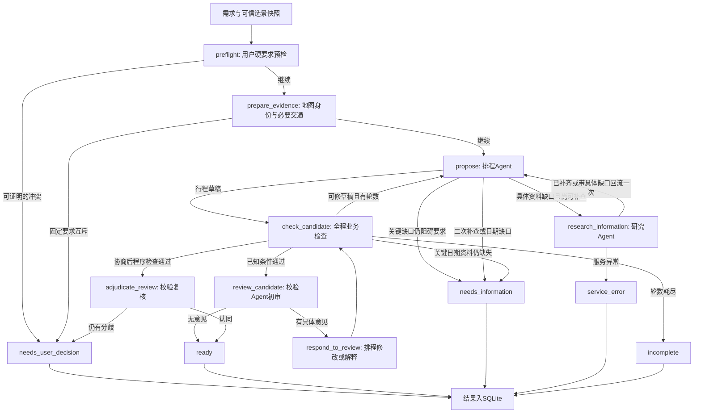

# 当前三角色 Agent 架构与后续边界

2026-11-15源码调研：[其他旅游Agent的架构对照与第三角色建议](AGENT_ARCHITECTURE_REVIEW_20261115.md)。该文保留当时的建议和外部版本证据；随后用户明确采用独立校验角色，以本文件和[一轮校验协商](REVIEW_NEGOTIATION.md)为当前实现说明。

更新：2026-11-15。当前接入 **排程Agent＋按需定向事实研究Agent＋独立校验Agent**，由LangGraph显式分流。校验与排程最多协商一轮，仍有分歧交用户协调；提示词质量和成本效果评估仍后置。初始景点排序与推荐摘要保持HTTP流水线，未迁成自主推荐Agent。

## 角色与程序的职责

| 组件 | 当前状态与职责 | 输出与限制 |
| --- | --- | --- |
| 排程Agent | 已实现，读取本次需求、地图证据、确认快照和最新草稿；使用地图地点/路线/餐厅工具 | `Itinerary`或`PlanningInformationRequest`；用户固定要求不能自行删除或放宽 |
| 定向事实研究Agent | 已实现，补排程明确提出的已知地点、旅行日期和字段 | `ResearchReport/ResearchFact`，使用受限搜索工具；只查缺口，不重做推荐或代替排程 |
| 独立校验Agent | 已实现，检查完整多天草稿与用户需求、体验及说明的一致性 | `ReviewReport`，具体意见须带日期/站序/地点、依据与建议；没有搜索或执行工具，不豁免硬检查 |
| 初始选景排序/摘要 | 仍是HTTP模型调用与普通函数流水线 | 候选排序、体验分组、每批最多5项介绍/照片；不是本轮新增的研究角色 |
| 普通程序节点 | 预检、地图身份核实、事实来源绑定、业务校验、版本检查、存储和副作用 | 依据结构化输入路由；不能把任意LLM“排不下”的判断当成无解证明 |

三个Agent复用现有DeepSeek配置和一个Key，各自保有角色消息和输出合同。普通草稿先进入程序业务校验，通过才初审；明确关键资料缺口才启动研究。排程逐项修改或解释拒绝，程序再次检查后交校验复核；仍不同意就显示具体分歧。代码沿用Pydantic AI和LangGraph，没有新增编排框架、主管Agent或通用重试Agent。更多Agent并不自动保证旅行体验更好。

## 已实现控制流



图的八个节点是`preflight`、`prepare_evidence`、`propose`、`research_information`、`check_candidate`、`review_candidate`、`respond_to_review`、`adjudicate_review`。程序检查通过后，尚未初审则进入初审，已有排程回应则进入复核，不同时走两条边。请求数或总时限耗尽会结束为`incomplete`，保存已有结果；不是为每个节点重分额度。源码入口见[real_planner.py](../tripweave/real_planner.py)，带备注的说明见[CORE_FLOW](CORE_FLOW.md)。

## 问题类别决定处理动作

| category | 当前可处理的问题 | 图动作 |
| --- | --- | --- |
| `draft_error` | 当前草稿违反已知规则，如时间衔接不足、景点数/游玩时长/占比/交通总时长超限、重复体验、完整停留未落入窗口 | 交排程结合草稿与其他天修订，再全量检查 |
| `missing_fact` | 排程明确提出的关键字段未知，或原来已声明关键字段的地点移到未研究日期 | 尚未研究则定向补查并按原因恢复一次，未知结果交排程一次；关键缺口仍阻碍硬要求或再次请求研究才结束为`needs_information` |
| `hard_conflict` | 程序能根据用户结构化硬要求与必要交通证据指出矛盾 | 结束为`needs_user_decision`，展示具体要求和依据，用户确认新版本后再生成 |
| `review_disagreement` | 校验复核后仍不认同排程安排或解释，是模型意见分歧 | `needs_user_decision`，展示双方观点、位置与草稿，后续协调操作待讨论；不宣称需求无解 |

硬冲突预检检查单项旧预约的每日边界，以及新增`visit_constraints`的窗口、最短停留和固定预约重叠。地点尚未解析时，不因两个不同名称就武断认定两处互斥；解析身份后再检查。固定预约间交通来不及时记录地图耗时、查询时间与相关要求；未手选酒店时，不把临时推荐酒店当作唯一出发点证明无解。

两个景点都21点开放，若能分两天就不构成必然冲突；同一地点相同预约可由一站满足，用户明确要求的不同合法预约可以保留。程序不因“轻松”这一一般偏好直接宣布无解，也不会通过自动顺延、搬景点或删除必去让检查勉强通过。体验取舍由模型结合本次需求判断。

`incomplete`与`service_error`另列为执行结果。有限次尝试没有成功、格式输出未完成或预算耗尽，不能升级成“硬要求互斥”；接口权限和响应异常也不是旅游需求无解。

## 结构化约束与事实交接

[planning_contracts.py](../tripweave/planning_contracts.py)定义实际合同：

```text
VisitConstraint
  constraint_id                 # 用户要求的稳定身份
  place_id / place_query        # 精确核实地点，不用附近景点替代
  windows[]                     # day + start_time + end_time，完整停留任选一窗
  min_duration_minutes          # 用户明确要求的最短停留
  fixed                         # true时唯一精确窗口，需booking且起止完全匹配

PlanningInformationRequest
  needs[]: place_id + day + fields + question
  reason

ResearchFact
  place_id + day + field        # opening_hours / last_admission / reservation_rules
  status                        # found / unknown
  value + quote + source_ids    # 模型输出；来源编号须绑定真实搜索摘录
  windows / closed / last_admission
```

研究任务只包含当前缺口需要的城市、地点名称/馆区/地址、旅行实际日期和问题，不传全部草稿、私人备注或排程历史。研究Agent只能通过`search_place_information`查本次允许的地点日期，不能自行扩成城市全量研究。返回后，程序将真实来源链接、查询时间、具体日期和`web_reported`附在事实中，再把必要事实交回排程。

程序要求found有来源、仅容忍空白格式差异的连续摘录和内容；摘录不在引用来源、同字段重复、显式日期不适用时明确诊断，预算内恢复一次。结构化时间端点必须出现在摘录中；只知道最晚入场不能编造完整开放窗口，未搜到不能当作关闭。只有明确结构字段进入时间检查，不从`value`猜时间。

这些检查证明事实引用与本轮搜索材料相连，**不证明来源本身权威、语义解释完全准确或未来一定适用**。网页报告不作为程序宣布硬互斥的唯一依据，不承诺已订票或有余票。官方规则、实时预约可得性和其他资料仍需要后续供应商能力及人工确认。

模型曾声明某字段关键后，换一天安排不能把它悄悄变成无需核实。程序按地点、实际日期与字段检查覆盖，缺失即返回`needs_information`；当前只覆盖已声明关键缺口，没有自动识别所有自由文本要求和所有景点必要事实。

## 修订范围与状态归属

普通错误能定位日期时，模型收到错误对应的日期/站序/地点、期望与实际值、目标日期完整站点，以及其他天只读参考。模型决定调整时段、顺序和灵活体验，程序只合并与检查。

补查可能影响多天，因此新事实第一次返回时，允许模型参考完整最新草稿做完整修订；之后恢复按实际错误日期局部修订。每一次修订都全程检查，避免修好一天却引入跨天重复或其他冲突。

当前状态分工：

| 所在位置 | 保存内容 | 恢复能力 |
| --- | --- | --- |
| LangGraph本次调用 | 消息、当前候选、问题、次数、研究事实、新事实标记及校验协商状态 | 内存运行；未开启checkpoint |
| SQLite业务库 | 需求/接受版本、选景草稿、确认快照、候选结果、失败草稿、事实、校验初审/回应/复核、问题、轨迹及用量 | 结果保存后可刷新/重启查看；不等于从失败节点自动继续 |
| 服务进程内 | 用户输入的供应商Key | 重启需重新配置；不写入业务库或公开报告 |

正常返回与已捕获异常会把已有草稿交给API保存；请求运行中突然退出时仍可能丢失尚未返回的内存状态。跨请求修订失败草稿、任意节点续跑、后台任务和checkpoint自动恢复尚未实现。

选景确认仍使用版本桥：服务端从SQLite勾选冻结`source_requirements_revision`、`selection_revision`、目标`requirements_revision`及所选精简资料，事务内比较写并记录事件。只交必要资料，网页和用户文本不能改变系统工具权限；目的地/选择改变时旧快照失效。接受要求`status/outcome=ready`且版本匹配；有新`review`字段还必须`approved`，旧历史不伪造校验记录。其他结果只能查看问题与草稿。

## 保留现有运行上限，评估后置

当前基线为一次规划默认6次模型请求、90秒、最多检查3份草稿；排程、研究、校验共享同一个`RunUsage`，SDK格式重试与工具循环也计入。校验协商最多一轮，新增完整修订同样计候选；没有工具往返时初审直接通过至少2次模型请求，协商通常至少4次，研究和修复会再消耗额度。定向研究只进入一个阶段，最多恢复一次、合计5次搜索；普通重复调用复用缓存，程序恢复可按失败字段换词补搜；地图最多50次请求，路段本轮复用缓存。

这些上限已经在运行代码中生效。本轮没有优化费用、比较提示词、批量追加真实测试或安装Pydantic Evals/DSPy等新依赖。质量与成本评估按用户要求后置；上述限制只是保持已有调用边界，不能据此宣称节省费用或提升成功率。

初始选景排序、摘要、换批与后续规划不属于同一个共享模型请求账本，跨阶段总token和人民币费用台账尚未实现。以后是否增加评测/追踪/优化组件，应等核心行为验证后再按实际缺口决定。

## 验证边界与未完成

此前两角色基线为306项Python通过、4项PostgreSQL跳过、34项前端通过。本次校验协商仍使用真SDK＋LangGraph配合HTTP模拟，最终结果见[QA记录](evaluations/V02_QA.md)。它检查角色交接、合同、权限、预算和接受门禁，不证明真实模型意见可靠或成功率提高。

此前浏览器检查了时间表单和本机硬互斥预检，API回读地图0次/模型0次；截图与回读在`.runtime/architecture-time-form-20261113.jpg`、`.runtime/architecture-ui-check-20261113.json`。研究回流后来已有真实样本，但没有新版可接受方案。**本次第三校验角色没有新增真实模型、地图或搜索测试**，既有质量问题不会因离线协商通过自动消失。

后续边界：自主研究/推荐角色迁移、复杂自由文本约束提取、完整多窗口组合求解、所有景点事实自动覆盖、跨请求草稿继续、checkpoint与后台恢复，以及质量和成本评估均尚未完成。本轮已实现的是有明确合同、权限及结束分支的核心编排。


## 2026-11-14 真实验证更新

此前“未做真实双角色联调”是2026-11-13状态，现已被一次真实回流样本补充：首次因服务沙箱网络10013失败、模型0；修正启动环境后，经用户另行授权再试，同输入24.706秒、6模型/17地图/1搜索，研究返回官网常规开放等3字段，排程生成草稿，但9项业务错误未通过且额度耗尽未完成修订，outcome=incomplete。两条记录保存，均未接受。证明实际研究交接发生，不证明最终规划可行或效果稳定。细节与截图见[evaluations/V02_QA.md](evaluations/V02_QA.md)，本轮未改业务代码、未再发第三次规划。


## 当前思考配置

三个角色均启用思考：排程max、研究high、校验max。环境变量`TRIPWEAVE_PLANNER_EFFORT/TRIPWEAVE_RESEARCH_EFFORT/TRIPWEAVE_REVIEWER_EFFORT`控制强度，thinking固定enabled。SDK显式用reasoning_content字段在各自工具循环内回传；完整思考不写候选/轨迹，不跨角色交接。候选与`/api/config`保存配置。单次输出上限分别6000/4000/6000，配置和统计入口见[用量说明](USAGE_OBSERVABILITY.md)。

原6次/90秒没有提高，尚未真实验证三角色使用这些额度是否充足。`max`只表示请求强度，不保证校验正确，也不能覆盖程序硬约束。参数依据：[DeepSeek思考模式](https://api-docs.deepseek.com/guides/thinking_mode/)。


2026-11-15补充：旧活动上限已替换为四项每日节奏指标，同景点当天分段计1、游玩分钟累计，比例分母固定；程序同步检查并返回具体日期/实际/上限，由排程Agent局部修订。每日统计随候选入SQLite。具体口径见[PROMPTS_CURRENT](PROMPTS_CURRENT.md#2026-11-15-每日节奏指标替代旧活动计数)。本次没有新增真实供应商测试。


当前资料不足的逐字段诊断、宽容引用匹配、一次按因恢复与排程回流，以[资料核检与恢复](RESEARCH_RECOVERY.md)为准；旧真实测试结论不作为新版效果证据。
