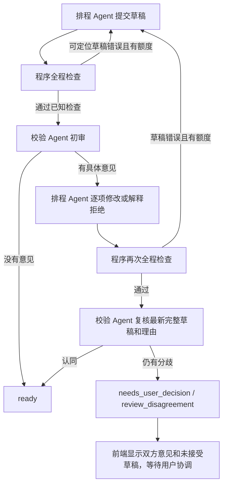

# 校验 Agent 与一轮协商

更新：2026-11-15。按用户确认，本次在现有排程、定向研究之外增加独立校验 Agent。复用 LangGraph、Pydantic AI 和现有 DeepSeek 配置，不新增框架、服务或 Key。

## 角色与权限

校验 Agent 关注整份行程是否贴合本次需求、体验与合理性，例如轻松程度、连续高强度游玩、用餐、交通缓冲和说明与时间字段是否一致。它只能读取给定资料并输出意见，没有搜索、预订、支付或修改数据库工具。缺少现实资料时必须说明未知，不能凭模型知识虚构营业、体力消耗或预约事实。

排程 Agent 负责取舍和修订。它可以采纳部分意见、拒绝其他意见，但必须逐项说明理由。校验意见的优先级低于用户明确要求，不能要求删除必去或改动固定预约来换取模型共识。

程序继续负责硬约束、身份、引用位置、预算、版本和保存。模型达成共识不是业务规则的例外，也不是现实可行性的保证。

## 实际流程

协商最多一轮，即“初审 → 排程回应 → 复核”。程序检查失败的修订仍走已有的有限草稿修复；修复后的最新完整草稿交回复核，不再开启第二轮模型辩论。请求数、总时限或候选次数先耗尽时结束为 `incomplete`，不能当作双方分歧或需求无解。

定向研究仍只补排程明确提出的地点、日期和字段。研究现已增加最多一次按因恢复，关键未知连具体诊断交回排程一次；仍阻碍硬要求才结束为 `needs_information`。该恢复属于研究阶段，不由校验Agent仲裁来源或豁免硬规则。

## 输出合同与上下文

源码见 [planning_review.py](../tripweave/planning_review.py)，固定提示词见 [PROMPTS_CURRENT](PROMPTS_CURRENT.md)。

| 合同 | 内容与程序检查 |
| --- | --- |
| `ReviewReport` | `summary` 和必填的 `suggestions`（最多5条）；显式空列表表示认同，漏字段不能自动批准。意见ID须唯一。 |
| `ReviewSuggestion` | 稳定 `suggestion_id`，具体日期/当天从1开始站序/地点ID，问题 `concern`、实际需求或证据依据 `requirement_basis`、建议 `proposed_change`。引用位置必须存在于本轮草稿；复核可引用原草稿中已删除的位置并说明。 |
| `PlannerReviewResponse` | 对初审的每个意见 ID 恰好回应一次，填写 `action=revise/decline` 和 `reason`。有采纳修订时提交 `patch`，只替换对应日期，确需换自动酒店时涵盖受影响的住宿日及次日。全拒绝时省略补丁。候选记录中的 `revised_itinerary` 仍保留程序合并后的完整修订结果。 |
| 复核报告 | 同样为 `ReviewReport`；已解决意见不再列出，未解决沿用原ID；修订引入的具体新问题也可列出。非空就转用户协调，不擅自放行。 |

校验获得完整多天草稿、当前需求、本次修订要求，以及相关地点、路线和已有事实。复核直接读取初审意见、规划决定和被引用的原站点。排程回应获得完整规划上下文和结构化初审报告。本次修订要求优先于旧安排，后续程序反馈修复也会显式传入该要求。研究继续只接收定向补查所需信息。

`route_table` 提供当前草稿每段的高德估算、待查询状态或同地点标志，另给按结构化时间计算的缓冲。其他已查路线以 `alternative_routes` 提供。程序合并排程补丁后再检查所有日期。

`checked_modes` 记录实际查询过的交通方式，老缓存缺少记录时显示未知。`ticket_status` 单独记录购票条件和实时余票的核实状态。校验逐项检查用户硬要求、多日游玩体验、自然语言说明与这些证据是否一致。

## 结果、前端与持久化

候选 JSON 增加 `review`：版本、协商状态、初审、原草稿、排程逐项回应及复核。它与 `draft/issues/trace/usage` 一起保存到现有 SQLite 候选记录，不需要新增表。正常返回或已捕获失败后可刷新、重启回看；仍不是图 checkpoint 或自动跨请求续跑。

| 情形 | 结果 |
| --- | --- |
| 初审无意见，或复核认同且程序检查通过 | `outcome=ready`，`review.status=approved`，再由接受接口检查需求和接受版本。 |
| 复核仍不同意 | `outcome=needs_user_decision`，`review.status=disputed`，问题类别 `review_disagreement`。前端展示具体位置、依据、规划回应、尚未解决意见与草稿，禁止接受。 |
| 模型输出合同/位置错误、预算/时限/候选次数不足 | 本次未完成，不伪造成实际规划分歧。已有协商材料保留供排查。 |
| 结构化用户要求可证明互斥 | 仍使用原 `hard_conflict` 分支。它与模型意见分歧共享需要用户决定的大类，但展示含义不同。 |

“规划分歧”只表示两个模型未达成共识，不表示用户需求不可能满足。用户如何选择保留意见、修改需求或继续规划，按用户要求留待下一轮讨论；本次不增加绕过检查的“强制接受”。旧历史没有 `review` 时沿用原查看和接受语义，不假装旧记录已经过新校验。

## 成本与验证边界

默认仍为排程 `max`、研究 `high`，新增校验 `max`；同一模型配置、同一 Key。新环境变量 `TRIPWEAVE_REVIEWER_EFFORT` 与 `TRIPWEAVE_REVIEWER_MAX_TOKENS`，后者默认6000。三个角色共享最多8轮模型调用、整轮180秒和最多检查3份草稿，工具往返和格式重试同样计入。研究一个阶段内最多恢复一次、合计5次搜索，地图预算不变。

这里的3份是采用并进入程序检查的草稿上限，不是保证模型只生成3份内容：第三份草稿之后仍可要求排程解释意见；若它又提交第四份修订，该回应保留在协商记录中，但新修订不采用，本次结束为未完成。

没有工具往返和格式重试时，首次生成后初审直接通过至少需要2次模型请求；发生协商通常至少4次。定向研究、草稿修订和额外工具调用会继续占用同一额度，不能保证8轮总能完成。没有自动提高预算，也没有因 `max` 就保证校验正确。

已有用量记录按 `role=reviewer` 统计校验请求，其输入、输出、思考、缓存与费用进入同一轮快照，人民币仍是按价表估算而非账单。协商增加真实模型调用时会增加费用；统计本身不新增收费请求。尚未比较产出一份可用方案的实际总成本或成功率。

本单元使用真 SDK 配合脚本化 HTTP 响应检查合同与路由，未增加真实 DeepSeek、高德或搜索调用。离线通过不代表真实校验意见可靠，也不证明现有预算已足够；最终检查结果以提交时的 [QA记录](evaluations/V02_QA.md) 为准。

当前资料不足的逐字段诊断、宽容引用匹配、一次按因恢复与排程回流，以[资料核检与恢复](RESEARCH_RECOVERY.md)为准；旧真实测试结论不作为新版效果证据。

2026-11-16经用户确认：默认实验预算调整为180秒、8轮，思考强度和单次输出上限不变。轮次按SDK已进入历史的模型响应计数，工具执行本身不占模型轮次；读取工具结果继续推理会产生下一轮。HTTP尝试另行记录，不能把轮次限额当绝对费用上限。旧候选保留当时6轮/90秒快照。
